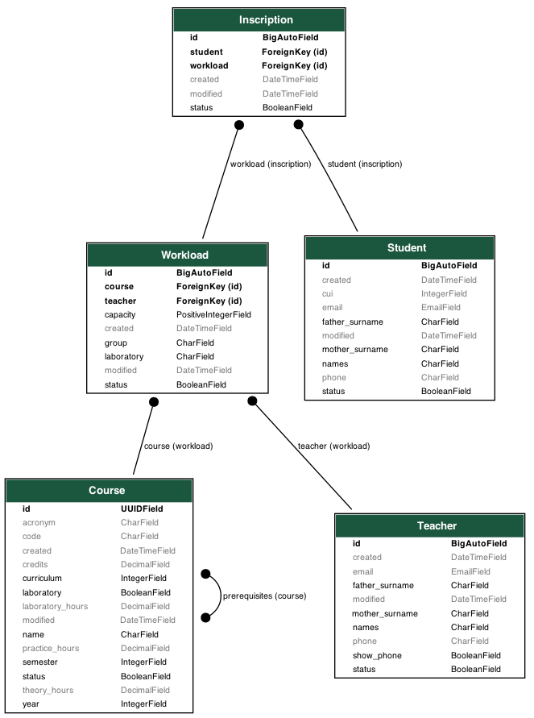

# Proyecto : enrollments

# Descripción de la aplicación web
- Se trata de una aplicación web que permite a los estudiantes inscribirse en cursos específicos.

| Equipo | Rol | Porcentaje |
| :--- | :--- | :---: |
| Richart Escobedo | Desarrollador frontend | 100% |
| Richart Escobedo | Desarrollador backend | 100% |
| | **Total** | **100%** |

| Entregables | URL |
| :--- | :--- |
| Repositorio | https://github.com/rescobedoq/enrollments.git |
| **Informes**[^1] | |
|lab07 |https://github.com/rescobedoq/enrollments/blob/main/informes/IDWeb_lab07_avance_proyecto.pdf|
|lab08 |https://github.com/rescobedoq/enrollments/blob/main/informes/IDWeb_lab08_avance_proyecto.pdf|
|lab09 |https://github.com/rescobedoq/enrollments/blob/main/informes/IDWeb_lab09_avance_proyecto.pdf|
|Informe Final |https://github.com/rescobedoq/enrollments/blob/main/informes/IDWeb_proyecto_informe_final.pdf|


# Tecnología utilizada[^2]

| Ítem | Tecnología |
| :--- | :--- |
| **Desarrollo** | GNU/Linux |
| | Git |
| | Github |
| | Vim |
| **Frontend** | HTML5 |
| | CSS3 |
| | JavaScript |
| **Backend** | NodeJS |
| | Express |
| | zod |
| **BD** | SQL |
| | Supabase |
| **Despliegue** | Docker |
| | Netlify |
| | Vercel |
| | Render |
| | Railway |


# Modelo de Datos[^3]


# Estructura del proyecto
```bash
.
├── backend
│   ├── package.json
│   ├── priv
│   ├── pub
│   │   ├── css
│   │   ├── fonts
│   │   ├── img
│   │   ├── js
│   │   └── others
│   └── README.md
├── bd
│   ├── bd.sql
│   └── README.md
├── frontend(opcional)
│   ├── package.json
│   ├── priv
│   ├── pub
│   │   ├── css
│   │   ├── fonts
│   │   ├── img
│   │   ├── js
│   │   └── others
│   └── README.md
├── img
│   └── enrollmentsv1.0.png
├── informes
│   ├── IDWeb_lab07_avance_proyecto.pdf
│   ├── IDWeb_lab08_avance_proyecto.pdf
│   ├── IDWeb_lab09_avance_proyecto.pdf
│   └── IDWeb_proyecto_informe_final.pdf
└── README.md

```

# Referencias
- https://askubuntu.com/
- https://git-scm.com/
- https://github.com/
- https://www.vim.org/
- https://neovim.io/
- https://html.spec.whatwg.org/multipage/
- https://www.w3.org/TR/2001/WD-css3-roadmap-20010523/
- https://javascript.info/
- https://supabase.com/
- https://www.docker.com/
- https://www.netlify.com/
- https://vercel.com/
- https://render.com/
- https://railway.com/

[^1]: Los informes deben estar en el repositorio del grupo en un subdirectorio llamado 'informes'.
[^2]: Se debe utilizar tecnología para frontend: HTML5, CSS3, JS nativo, flexbox, Bootstrap y para backend: NodeJS + express.
[^3]: La base de datos debe estar en la nomenclatura y estándares explicados en clase, se puede usar, MySQL, PostgreSQL o Supabase.
